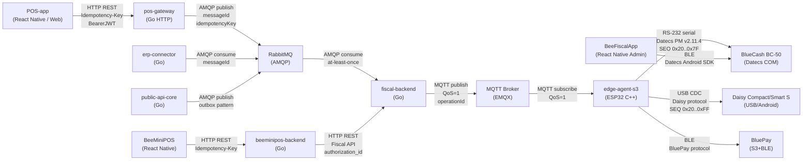

# COMPONENT_MAP — MVP1 Fiscal Flow Component Map

Дата: 2026-10-28 · Метод: статический анализ исходников · Версия: 1.0

## Диаграмма потока данных (Mermaid)

## Таблица стрелок: протокол / аутентификация / идемпотентность / таймаут / UNKNOWN

| # | От | До | Протокол | Аутентификация | Идемпотентность | Таймаут | При UNKNOWN |
|---|---|---|---|---|---|---|---|
| 1 | POS-app | pos-gateway | HTTP REST TLS | Bearer JWT (Expo/OIDCprovider) | `Idempotency-Key: UUID` | 30 с | Клиент повторяет запрос с тем же ключом |
| 2 | pos-gateway | RabbitMQ | AMQP 0-9-1 TLS | username/password | `messageId` (UUID) + `idempotencyKey` | publisher confirms | Сообщение остаётся в очереди; consumer retry |
| 3 | RabbitMQ | fiscal-backend | AMQP 0-9-1 | username/password | Inbox-таблица `(messageId ON CONFLICT DO NOTHING)` | N/A (QoS) | Broker redelivers; fiscal-backend дедуплицирует |
| 4 | fiscal-backend | MQTT | MQTT 3.1.1 TLS | mTLS сертификат устройства | `operationId` (UUID) в payload | 6 с (Datecs), 3 с (Daisy) | `status=UNKNOWN`; reconciler lookup через N мин |
| 5 | MQTT | edge-agent-s3 | MQTT QoS=1 | CA cert + device cert | QoS=1 (broker гарантирует at-least-once) | 30 с подписки | PUBACK потерян → повтор от broker; s3 проверяет seq |
| 6 | edge-agent-s3 | BC-50 | RS-232 Datecs PM v2.11.4 | PIN-пароль кассира | SEQ 0x20..0x7F (cyclic) | 6 с deadline | Нет ответа → `UNKNOWN` в s3; наверх не пишется |
| 7 | edge-agent-s3 | Daisy | USB CDC Daisy v2.0 | нет | SEQ 0x20..0xFF (cyclic) | 3 с deadline | Нет ответа → `UNKNOWN` в s3 |
| 8 | edge-agent-s3 | BluePay | BLE GATT | BLE паровка + ключ | per-command sequence | 10 с | `UNKNOWN` в s3 |
| 9 | BeeMiniPOS | beeminipos-backend | HTTP REST | Bearer JWT (MiniPOS session) | `Idempotency-Key: UUID` per-request | 15 с | 503/UNKNOWN → UI показывает статус |
| 10 | beeminipos-backend | fiscal-backend | HTTP REST | Bearer JWT (service account) | `authorization_id` | 15 с | 202+UNKNOWN → reconciler |
| 11 | BeeFiscalApp | BC-50 (BLE) | BLE Datecs Android SDK | PIN-пароль + BLE pairing | нет (приложение Admin) | 30 с (BLE) | Ошибка → UI сообщение |
| 12 | erp-connector | RabbitMQ | AMQP consume | username/password | `messageId` inbox | N/A | Broker retry; EC-02 UNKNOWN=FAILED (BUG) |
| 13 | public-api-core | RabbitMQ | AMQP publish outbox | username/password | `operationId` outbox | tx commit | Retry через `retryCanonicalOperation` |
